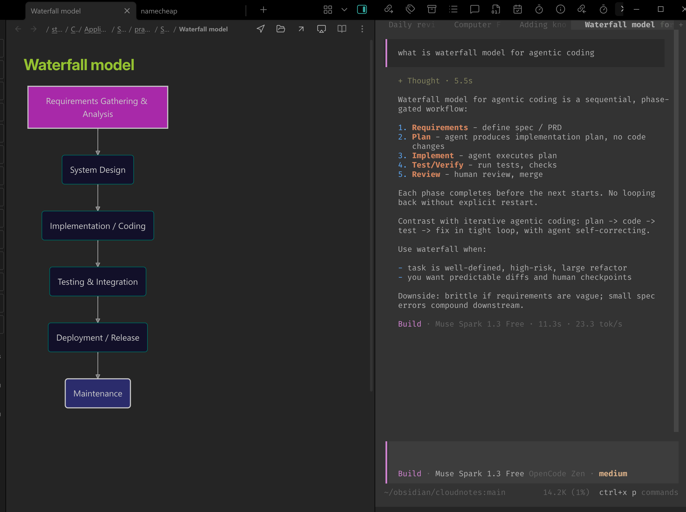
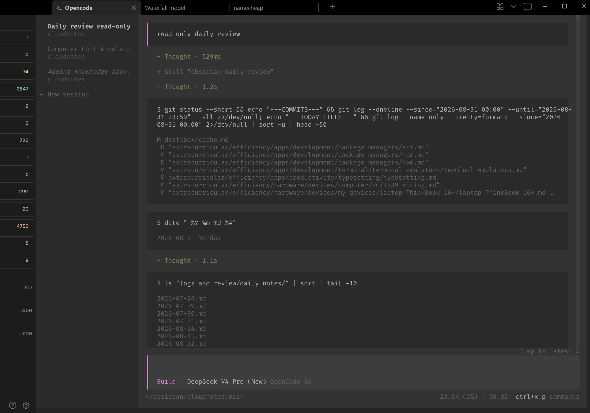

# Obsidian OpenCode

A plugin that embeds the OpenCode CLI directly into Obsidian. Browse conversation history and resume work without leaving your vault.

## Demo

Work with vault notes and OpenCode side by side:



Use OpenCode 2's multi-session interface in a full Obsidian editor tab:



## Features

- **Native OpenCode Execution:** Runs the OpenCode CLI directly inside Obsidian using an integrated terminal, ensuring smooth performance for long sessions.
- **Vault-Centric Workflow:** Automatically spawns the agent in your vault's root, ensuring it has immediate access to your notes and project files.
- **Drag and Drop Context:** Drop notes or folders from Obsidian's file explorer into the terminal. Notes become file line references. Folders paste their vault-relative path as plain text with a trailing slash, such as `extracurricular/ACG/anime/`, including names with spaces or Unicode and mixed selections. Nothing is submitted automatically.
- **Session Manager:**
  - **History Browser:** View a list of all your past OpenCode sessions with timestamps.
  - **Conversation Preview:** Inspect message history, token usage and model details.
  - **One-Click Restore:** Instantly resume a previous session in the embedded terminal.
  - **Export to Markdown:** Save entire conversation threads as formatted notes in your vault for documentation or review.

## Platform Support

- **Linux**: stable on my daily driver, not tested on all distros.
- **WSL2/X410**: Supported with the Linux Obsidian app and formal OpenCode V2. Text copy/paste, OSC 52, Windows clipboard image paste, and copying rendered terminal images use a Unicode-safe Windows PowerShell bridge. WSLg is outside this support contract.
- **Windows**: Beta support on Windows 10 version 1903 (build 18362) and later through packaged ConPTY. Node.js must be available on `PATH` for the isolated PTY helper.
- **macOS**: Experimental.

## Known Issues

- **Empty external-editor prompts are not applied:** In both OpenCode 1 and OpenCode V2, opening the prompt in an external editor, deleting all content, and saving leaves the previous prompt in place. This also reproduces when OpenCode runs outside Obsidian, so it must be fixed upstream.

- **OpenCode V2 can time out while pasting large images:** This reproduces in both the embedded terminal and standalone OpenCode V2, so it is not caused by the plugin. A V2 preview build configured clipboard reads with a 1-second timeout and an 8 MiB read limit; a 54.5 MB, 2720 x 18447 PNG reports `Clipboard read timed out`. Its separate local-file attachment limit is 20 MiB, so attaching that same file by path is also unsupported. OpenCode 1.4.6 on Linux reads image data through `wl-paste` without those explicit clipboard limits, so the large image may work there, but that comparison has not yet been verified manually.

- **large session preview:** While the buffer size for exporting sessions has been increased (up to 100MB), exceptionally large or deeply complex OpenCode sessions with massive token counts may still occasionally fail to preview or load properly.

- **not tested on all Linux distros:** While the plugin should work on major distros, it's only tested on manjaro, ubuntu, and fedora.

- **Experimental Windows pty:** It's usable but far from linux and macos experience.

- **shortcuts conflicts:**: Default opencode shortcuts like `Ctrl+P` could conflict with obsidian shortcuts. A solution for now is to always use leader key for opencode shortcuts.

## Integrations

### LaTeX render

OpenCode CLI doesn't support LaTeX render natively. I made this opencode plugin for myself: [opencode-latex](https://github.com/kriss-spy/opencode-latex)


### Obsidian

Personally, i use kepano's [obsidian skills](https://github.com/kepano/obsidian-skills) and some of my [obsidian skills](https://github.com/kriss-spy/obsidian-skills).

Any other general community project (MCP, skill, framework...) that connects coding agents with obsidian should work out of the box, as long as it doesn't specify the main interface.

### Templates

I've always wanted a natural way to let opencode discover and use folder templates. [Templater](https://github.com/silentvoid13/Templater) doesn't do that out of the box. So i made [frontmatter-templater](https://github.com/kriss-spy/frontmatter-templater) to let you define folder template in folder note. In that way opencode should naturally discover and use the template when exploring a folder.

## Installation

### From Obsidian Community Plugins (Recommended)

1. Open Obsidian and go to **Settings** → **Community plugins**
2. Click **Browse** and search for **OpenCode**
3. Click **Install**, then **Enable**

### Manual Installation

1. Download `main.js`, `manifest.json`, and `styles.css` from the [latest release](https://github.com/kriss-spy/obsidian-opencode/releases/latest)
2. Create a folder named `opencode` in your vault's `.obsidian/plugins/` directory
3. Copy the downloaded files into that folder
4. Reload Obsidian and enable the **OpenCode** plugin in Community Plugins settings

## Usage

- **Open terminal:** Run **OpenCode: Open Terminal** from Obsidian's command palette (`Ctrl/Cmd + P`). OpenCode starts in your vault root.
- **Manage sessions:** Run **OpenCode: Open conversations** to browse, resume, or export sessions. You can also start a new session from the conversations panel.
- **Link to sessions:** Run **OpenCode: Copy session link** in an OpenCode V2 terminal, or use **Copy session link** in the conversations panel. Paste the link into a note to resume the session later. The vault, session, and working directory must still exist on the target machine.
- **Add note context:** Run **OpenCode: Add active line or selection to terminal** to insert a reference to the current line or selected lines into your draft without sending it. You can assign a hotkey in **Settings → Hotkeys**.
- **Open terminal links:** Click URLs or Markdown file paths in terminal output. Hold `Ctrl/Cmd` when OpenCode captures mouse input. See [terminal link behavior and supported paths](docs/terminal-links.md).
- **Maximize or close:** Run **OpenCode: Toggle terminal tab maximize** to expand or restore the terminal. Run **OpenCode: Close terminal** or press `Ctrl+Shift+W` to close it.
- **Configure OpenCode:** In **Settings → OpenCode**, leave the executable path blank for auto-detection or specify a command or full path. You can also configure CLI arguments, environment variables, and terminal appearance.

**Notes:** `Ctrl+Z` cannot suspend the embedded CLI unless it is remapped for another action (such as undo). On WSL2 with X410, clipboard integration supports text and images through the Windows bridge; see **Platform Support** above.

## Development

Development requires Node.js 22.12 or newer.

To develop the plugin, you can run the development script which automatically rebuilds the plugin when files change:

```bash
npm run dev
```

Unit tests run with `npm test`. To create a fresh isolated vault and test the built plugin inside a sandboxed Obsidian instance, run:

```bash
npm run test:obsidian
```

Use `npm run test:obsidian:smoke` for the smaller baseline suite. Windows contributors can also run `npm run test:obsidian:windows-ui` to exercise the installed OpenCode CLI and native terminal interactions.

See [Testing in Obsidian](docs/testing-obsidian.md) for setup, coverage, evidence, and limitations.

## Acknowledgements

- **Terminal integration approach** inspired by [polyipseity/obsidian-terminal](https://github.com/polyipseity/obsidian-terminal) — the Python PTY proxy with `pty.fork()` and 4-pipe stdio for resize control (FD 3).

## License

MIT License
